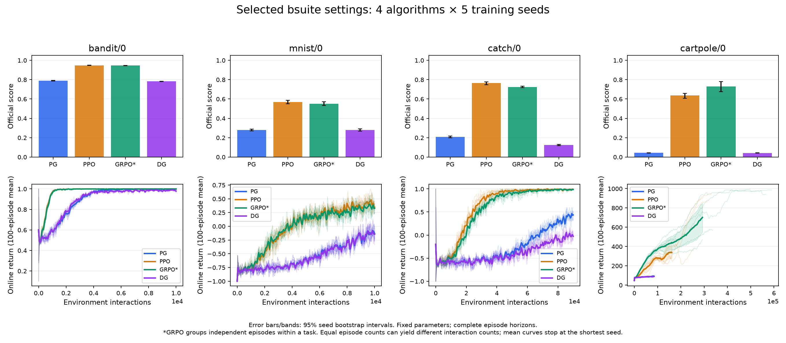

# 实验结果

共完成 **80 次独立训练**：PG、PPO、GRPO 和 DG 在 4 个 bsuite 任务上分别运行 5 个随机种子。表中为官方评分均值，分数越高越好。

|任务|PG|PPO|GRPO|DG|
|---|---:|---:|---:|---:|
|Bandit|0.7900|**0.9480**|0.9461|0.7819|
|MNIST|0.2789|**0.5681**|0.5503|0.2796|
|Catch|0.2074|**0.7643**|0.7236|0.1249|
|CartPole|0.0426|0.6360|**0.7280**|0.0423|

**结论：**PPO 在 Bandit、MNIST 和 Catch 上最好；GRPO 在 CartPole 上最好；PG 和 DG 整体表现较弱。
